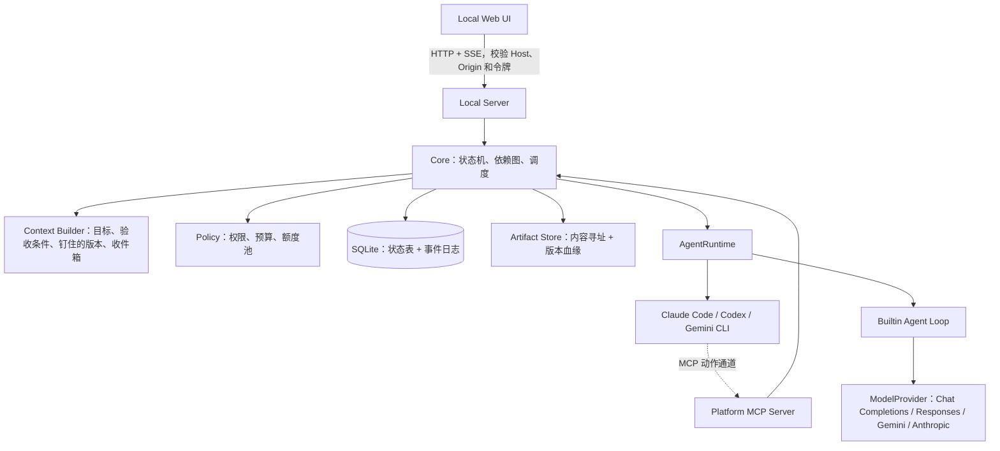

# 多模型 AI 团队协作平台｜项目草案

> 暂定项目名：Concordia
> 
> 版本 v0.4 Draft · 2026-11-27 · 面向个人使用的 Linux、macOS 和 Windows 本地应用。本次在 v0.3 的基础上扩展目标系统，补充三平台的凭据存储、进程取消及验收要求。
> 
> 本文为初步需求与技术方案，可作为后续交给 Codex、Claude Code 或其他开发 Agent 的任务依据；尚非已实现或经过真实账号验证的产品。

## 1. 项目目标

开发一个本地运行的多 Agent 协作平台。用户能够将不同 AI 分配到不同岗位，让它们围绕共同目标开会、分解任务、并行执行、互相审查和汇报成果。

核心需求不是把所有模型统一成某家厂商的 API，而是建立一个**与认证方式、模型厂商和 API 协议解耦的调度层**。既能使用现有 AI 订阅，也能使用自己的 API Key 和中转站。

首版以缩短从提出需求到验收的时间为目标。默认团队按下表分工，每项需求只调用有交付任务的成员。用户可在 UI 中替换任一岗位的模型或连接。

| 岗位 | 默认成员 | 负责的决定或交付物 |
|---|---|---|
| 团队负责人 | Claude | 拆需求、定优先级和验收条件，处理跨岗位分歧，验收最终版本 |
| 前端 | Gemini | 界面、交互和空状态，使用后端提供的接口样例先行开发 |
| 后端 | GPT | 接口约定、返回样例和后端实现，直接回答前端的技术问题 |
| 测试与批量执行 | DeepSeek | 准备样例数据、编写边界用例、整理联调结果，承接规则明确且可检查的重复工作 |
| 资料与交付支持 | Kimi | 整理资料、复现步骤和使用说明，按需要参与 |

## 2. 核心原则（不可妥协）

1. **API 和 CLI 是并列的一等接入方式。** 每个 Agent 必须能够独立选择接入类型、连接配置和模型；同一团队内允许混用。
2. **模型名称自由输入。** 不根据模型 ID 判断厂商，不硬编码模型白名单，不强制获取 `/models` 才允许添加模型。
3. **不接管现有 CLI 认证。** 不自行实现 OAuth，不提取订阅 Token，平台不读取或修改用户主目录中 Claude Code、Codex CLI 等程序的配置和认证文件（如 `~/.claude`、`~/.codex`），不要求用户为了使用平台重新登录。
4. **API Base URL 完全由用户指定。** 不因为选择 OpenAI 协议而强制访问 OpenAI 官方服务器。连接测试使用用户实际配置的地址、模型和协议。
5. **失败时不静默切换连接或计费方式。** 任何模型回退、API 付费回退均须用户明确授权。
6. **本地优先。** 无平台账号、无强制云端后端、无强制 Docker。默认仅监听 `127.0.0.1`。
7. **协议适配与业务逻辑分离。** 新增模型供应商或 CLI 不应要求重写团队调度器。

## 3. 模型连接系统

### 3.1 API 接入

首版目标支持：

| API 协议 | 优先级 | 说明 |
|---|---|---|
| OpenAI Chat Completions | P0 | 兼容常见第三方中转站及 Kimi、DeepSeek 等模型 |
| Gemini Native API | P0 | 直接接入 Gemini 原生接口 |
| OpenAI Responses | P0 | 接入使用 Responses 协议的模型和网关 |
| Anthropic Messages | P1 | 支持 Anthropic 原生及兼容接口（有 API Key 时使用） |

每个连接允许配置：

- 显示名称、协议类型、Base URL、API Key（可选，取决于网关）。
- 自定义请求头、默认模型 ID、模型别名、自定义请求参数 JSON。
- 超时、最大并发、是否启用流式传输、重试策略。
- 模型能力：是否支持视觉、原生工具调用、结构化输出、推理参数；允许手动设置。
- 连接测试：真实最小请求、HTTP 状态、返回内容、耗时、Token 用量（如果可用），并展示脱敏后的原始错误。

URL 设计要求：明确 Base URL 是完整 API 根路径，避免重复拼接 `/v1`。必要时允许自定义 endpoint 覆盖默认路径。不能通过厂商名称猜测网关协议。

一个连接可注册多个模型。例如某 OpenAI 兼容中转站同时出售 GPT、Kimi、DeepSeek、Claude 等模型，用户只需创建一个连接，再添加任意数量的模型 ID。各模型可以覆盖默认参数。

### 3.2 CLI 接入

首版目标：Claude Code、Codex CLI；Gemini CLI 可随首版一起实现，若版本兼容性影响核心交付则列为紧接的扩展。DSH、OpenCode、Devin CLI 等后续通过插件适配。

每个 CLI 连接允许配置：

- CLI 类型、可执行文件路径（自动探测或手动指定）、模型 ID（可选）、工作目录。
- 启动参数、可选环境变量覆盖、超时、权限策略。
- 会话恢复策略：默认每个「成员 + 任务」一个会话，同一任务的重试和返工可恢复该会话；不跨任务复用会话，不混用不同 Agent 的会话 ID。跨任务需要的背景通过交接内容传递（见 4.6）。
- 健康检查：可执行文件存在、版本、官方命令能够成功完成最小非交互任务；优先使用 CLI 自身提供的认证状态检查。

实现方式：后端使用子进程调用官方、未修改的 CLI，解析其机器可读输出或标准输出。CLI 的登录及账号权限由用户自行在原生程序中管理。平台不是订阅反代服务，不对外提供订阅账号的 API 转售或共享。

每次执行单独管理整棵 CLI 进程树。Linux 和 macOS 使用独立进程组，取消时向整组发 SIGTERM，宽限期后向仍存活的组发 SIGKILL。Windows 使用 Job Object 托管整棵进程树，先向其控制台请求正常退出，宽限期后强制终止作业中的剩余进程。两种路径都须覆盖父进程提前退出的情况。登记进程标识及启动时间，防止误认复用的 PID。重启时先清理可确认属于上次执行的遗留进程，再核对中断的执行（见 4.7）。

**复用用户已有的 CLI 登录。** 由原生 CLI 自行读取配置和认证文件。Linux 桌面启动器、macOS Finder 和 Windows 资源管理器启动程序时，PATH 都可能与交互终端不同。各平台须支持指定可执行文件的绝对路径。找不到程序时提供诊断，提示用户核对路径。

图形应用补全 PATH 的常见做法是读取登录 Shell 的完整环境。这会把 Shell 配置里的 `ANTHROPIC_API_KEY`、`OPENAI_API_KEY` 等变量一并传给 CLI，可能让订阅计费变成 API 计费，违反原则 5。需要从登录 Shell 补全搜索路径时，只取 PATH。其余环境变量按白名单传递，用户配置的覆盖项逐项列出。健康检查只列出可能改变认证或计费的变量名及来源，由用户决定是否传入。

如果检测到现有 API Key / 环境变量可能改变订阅计费，则提示用户选择并确认。无法可靠确认实际计费方式时标记为「未知」，不得宣称一定消耗订阅。CLI 的订阅可用性以官方条款、当前版本和本机真实测试为准。

### 3.3 Agent 配置必须可以切换

```yaml
quota_pools:
  - id: claude_subscription
  - id: gateway_account

connections:
  - id: claude_local
    type: cli
    cli: claude_code
    quota_pool: claude_subscription
  - id: codex_local
    type: cli
    cli: codex            # 未指定 quota_pool 时自成一池
  - id: my_openai_gateway
    type: api
    protocol: openai_chat_completions
    base_url: https://gateway.example.com/v1
    credential: keychain:my_openai_gateway
    quota_pool: gateway_account
  - id: gemini_api
    type: api
    protocol: gemini_native
    base_url: https://generativelanguage.googleapis.com/v1beta
    credential: keychain:gemini_api

agents:
  - name: 团队负责人
    role: lead
    connection: claude_local
    model: opus
    reports_to: user
  - name: 前端
    role: frontend
    connection: gemini_api
    model: gemini-custom-id
    reports_to: 团队负责人
  - name: 后端
    role: backend
    connection: codex_local
    model: default
    reports_to: 团队负责人
  - name: 测试与批量执行
    role: qa
    connection: my_openai_gateway
    model: deepseek-custom-id
    reports_to: 团队负责人
  - name: 资料与交付支持
    role: docs
    connection: my_openai_gateway
    model: kimi-custom-id
    reports_to: 团队负责人
```

此处仅为数据结构示意，模型 ID 和地址不保证真实可用，`credential` 是逻辑引用。`keychain:` 后的名称在当前系统的用户凭据存储中解析（见第 6 节）。连接配置与 Agent 配置分开保存；UI 提供独立的连接选择器和模型输入框。切换连接时不得自动修改其他 Agent。已有任务执行期间切换连接须先确认或停止当前执行。

### 3.4 额度池

多个连接可能消耗同一份额度，例如以同一订阅登录、但工作目录或权限参数不同的两个 Claude Code 连接，或同一中转站账户下的多个连接。用「额度池」表达这种共享：每个连接属于一个额度池，未指定时自成一池。并发上限、调用预算和限流状态按池计算，同池的岗位共用并发空位。某个池遇到限流或额度耗尽时，暂停该池的新派发并提示用户，不影响其他池，也不改用其他池。

## 4. 多 Agent 协作

### 4.1 团队与角色

- 创建多个独立项目、团队及工作区。
- 自定义角色、系统提示词、模型、直属上级、工具权限和预算。
- 支持管理者、执行者、审查者等预设岗位，也支持自由组合。
- 每个 Agent 拥有独立会话和私有工作上下文，通过明确消息共享需要的内容。

### 4.2 四种运行模式

| 模式 | 工作逻辑 |
|---|---|
| 会议模式 | 多模型依次发言、相互回应，由主持人总结，用户可中途加入 |
| 公司模式 | 管理者创建并分配子任务，成员并行执行、汇报，管理者审查和验收 |
| 并行模式 | 多个模型独立完成相同任务，再比较结果 |
| 审查模式 | 一个模型产出成果，其余模型提出问题，必要时返工 |

四种模式共用一个调度器，区别只在工作流模板，都由任务、交付物槽位、消息和审查任务组合而成：并行模式是若干张输入相同的任务加一张比较任务，审查模式是产出任务加审查任务和返工循环，会议模式是由主持人推进的一串发言任务。新增模式只加模板，不改调度器。

### 4.3 调度机制

管理者不能仅口头声称已经分配任务。调度器必须实际创建任务、指定负责人并调用对应的 Agent 运行时（见 8.1）。

基本流程：用户提出目标 → 管理者生成工作流 spec → 调度器校验并展示与当前计划的差异 → 用户批准（可配置） → 调度器在一个事务内创建任务、槽位及依赖 → 执行者运行并发布带版本的交付物 → 审查或返工 → 验收。

系统应支持暂停、取消、重试、人工修改任务、重新指派和失败恢复。任务、消息和调用记录持久化，避免程序重启后丢失。未完成的调用不能因重启被误判为成功。

#### 依赖挂在交付物版本上

下游等的是一份交付物，不是上游整张卡完成：GPT 交出接口样例 v1，Gemini 即可开工，GPT 的任务仍在进行。因此依赖建立在交付物槽位上，而不是任务之间。

| 实体 | 说明 |
|---|---|
| 需求（主卡） | 目标、验收条件、必需交付物 |
| 任务（子卡） | 负责人；声明产出哪些槽位、消费哪些槽位及版本策略 |
| 执行 | 一次任务可多次执行；记录执行编号、连接、输入版本、产出版本、时间和用量 |
| 交付物槽位 | 一类交付物，如「接口约定」「界面草稿」「联调记录」 |
| 交付物版本 | 槽位的某一版。`based_on` 记录它基于哪些上游版本；内容类型为文本、文件集或 Git 提交 |
| 问题 | 挂在卡上，记录提问人、收件人、状态和因果链跳数 |
| 事件 | 追加式记录，见 4.7 |

- 版本策略分「最新」和「钉住某版」。所消费的槽位都出现满足策略的版本时，任务解除等待。
- 上游发布新版本时须标明是否为不兼容变更。调度器沿 `based_on` 找出建立在旧版本上的下游成果，标记为「基于旧版本」。不兼容变更使策略为「最新」的下游任务重新进入「已就绪」，计入返工次数；兼容变更和「钉住」策略只在卡上提示。
- 验收绑定一组版本快照，而不只看卡片状态。快照中的成果不能建立在已被不兼容变更取代的上游版本上。
- 「在等谁」「缺哪份交付物」「哪份交付物能解除最多张卡的等待」都由依赖图实时计算，不作为文本保存。
- 首版交付物包括文本和 Git 提交（成员在各自 worktree 中的提交，见 6.1），文件集类型预留。

#### 任务状态与看板投影

任务状态是唯一的权威状态：等待依赖、已就绪、运行中、等待用户决定、审查中、已暂停、完成、失败、已取消。完成、失败、已取消为结束状态；完成可因上游不兼容变更重新打开，失败可由用户手动重试。执行另有自己的状态：运行中、成功、失败、已取消、中断、已作废（迟到或已被取代的结果）。

| 转移 | 触发与条件 |
|---|---|
| 新建 → 等待依赖 / 已就绪 | 应用 spec 时按依赖是否满足决定 |
| 等待依赖 → 已就绪 | 所消费槽位都有满足策略的版本 |
| 已就绪 → 运行中 | 调度器领取：预算、权限和额度池并发均有空位；领取与登记执行编号在同一事务 |
| 运行中 → 审查中 | 当前有效的执行提交结果 |
| 运行中 → 已就绪 | 可重试的错误（如超时、5xx），且重试次数未用尽 |
| 运行中 → 失败 | 不可重试的错误，或重试次数用尽 |
| 运行中 → 等待用户决定 | 认证失败、限流、余额或预算用尽，或需要权限、计费确认（见第 7 节） |
| 审查中 → 完成 | 验收通过 |
| 审查中 → 已就绪 | 打回返工，返工次数未用尽 |
| 审查中 → 等待用户决定 | 返工次数用尽，或分歧需用户决定 |
| 等待用户决定 → 已就绪 / 已取消 | 用户决定继续或放弃 |
| 完成 → 已就绪 | 上游发布不兼容的新版本，且消费策略为「最新」 |
| 失败 → 已就绪 | 用户手动重试 |
| 未结束的任务 → 已暂停 → 恢复 | 用户暂停；恢复时按依赖重新计算为等待依赖或已就绪 |
| 未结束的任务 → 已取消 | 用户取消或全局停止 |
| 重启时 运行中 → 等待用户决定 | 未完成的执行标为中断，由用户决定是否重试 |

看板列是任务状态的纯投影，不单独保存：

| 看板列 | 任务状态 |
|---|---|
| 等输入 | 等待依赖；已就绪（标「已就绪」） |
| 进行中 | 运行中 |
| 待验收 | 审查中 |
| 已交付 | 完成 |

等待用户决定、已暂停、失败、已取消的卡留在进入该状态前所在的列，以状态标记显示。

#### 计划即 spec

团队负责人产出的计划是一份声明式工作流 spec，写明主卡、子卡、负责人、产出与消费的槽位、版本策略、验收条件和预算。spec 本身也是带版本的交付物。调度器只接受通过校验的 spec：负责人存在、依赖无环、权限和预算在允许范围内。校验通过后向用户展示与当前计划的差异，批准后在一个事务内应用。

阶段 3 的固定流程是一份手写 spec，阶段 4 改由负责人生成同一格式的 spec。两个阶段共用调度器，只是 spec 的来源不同。

### 4.4 调度动作协议

不把原生 Function Calling 作为硬性条件。平台提供统一的有限动作协议，例如 `create_task`、`assign_task`、`publish_artifact`、`read_artifact`、`ask_question`、`send_message`、`submit_result`、`request_review`、`run_project_command`。动作的 schema 只维护一份，由它生成各 API 协议的原生工具定义、MCP 工具定义、纯文本 JSON 的提示说明和后端校验器，避免多处定义漂移。

| Agent 类型 | 动作通道 |
|---|---|
| 支持工具调用的 API 模型 | 原生工具调用，由平台内置的 Agent 循环执行 |
| 不支持工具调用的 API 模型 | 受约束的 JSON 文本输出 |
| CLI（Claude Code、Codex 等） | 平台在本机提供 MCP server 暴露动作协议，每次调用时经命令行参数注入 MCP 配置 |

CLI 走 MCP 后，执行中途也能提问、取阅交付物和发布阶段性版本，不必等最终输出再解析。注入只作用于平台发起的那一次调用，不写入 `~/.claude`、`~/.codex`。CLI 若支持把权限请求转交给 MCP 工具，平台可在自己的界面中显示审批。MCP server 只接受平台为该次执行签发的令牌，令牌绑定执行编号，执行结束即失效。具体参数在实施时按当前版本核实；不支持 MCP 的 CLI 退回解析最终输出中的 JSON。

所有动作由后端校验角色权限、参数和任务状态。无效 JSON 仅进行有限次数修复，不能直接执行模型输出的任意命令。无法稳定输出动作的模型仍可作为普通讨论或审查 Agent 使用。

### 4.5 任务板与交接规则

任务板按需求分组。主卡写目标、验收条件和必需的交付物。子卡标明负责人、下一步、正在等的输入和依赖当前成果的成员。板面使用「等输入」「进行中」「待验收」「已交付」四列。「等输入」的卡写明卡点和提供者，输入已齐但尚在排队的卡标记为「已就绪」。暂停、失败、取消和等待用户决定的卡保留实际状态。板顶优先提示哪份交付物可以解除最多张卡的等待。事件推动移卡，用户可手工调整优先级、改派或暂停。

**以“按负责人筛选任务”为例**，Claude 在主卡写下三项验收条件。用户能筛选指定成员、查看未分配任务、清除筛选恢复全部。

| 触发事件 | 调度器的处理 |
|---|---|
| GPT 交出接口参数和返回样例 v1 | 保存带版本的交付物，通知依赖它的 Gemini 和 DeepSeek。Gemini 用样例做控件，DeepSeek 据此写用例，GPT 继续实现接口。 |
| Gemini 对「未分配」参数提问 | 问题挂在卡上并送入 GPT 的待办。Gemini 可继续做无关的界面工作。GPT 回复后更新约定，调度器只通知用到该约定的成员。 |
| 真实接口、控件和用例全部就绪 | 调度器把这组版本的提交合并进联调 worktree，DeepSeek 在其中运行项目声明的测试命令，附上结果或带复现步骤的失败用例。Kimi 可在控件定稿后补说明。 |
| 联调记录提交 | Claude 对照三项条件验收。失败项发回对应负责人，默认允许一次返工，仍有分歧时交给用户决定。说明是否影响验收由主卡预先指定。 |

普通进度只写入卡片。需要答复的问题按收件人投递，同一卡的相关问题可以合并处理。每次交接传目标、验收条件、相关版本的成果和具体问题，成员可按需取阅完整材料。岗位间的技术澄清直接进行，改变需求、优先级或验收条件的分歧交给 Claude。

调度器检查依赖、权限、余额或调用预算，以及连接和额度池的并发空位。共享同一订阅额度的岗位共用并发限制（见 3.4）。一次任务可以有多次执行，每次均记录执行编号、所用连接、输入与产出版本、时间和可获取的用量。领取任务与登记执行编号在同一数据库事务内完成。相同交付事件只唤醒同一份下游工作一次。取消后的迟到结果仅存入历史，验收绑定当前有效的执行和成果版本。程序重启后先核对中断的执行，再由用户决定是否重试。

### 4.6 上下文组装与消息投递

每次执行的输入由上下文组装模块统一生成：主卡目标与验收条件、本任务所消费的交付物版本、收件箱中待答复的问题和必要的交接说明。支持工具调用的成员可用 `read_artifact` 按需取阅全文，不支持的成员由组装模块内联必要内容。Token 上限在这一层执行。每次执行的输入包按内容哈希存档，用于追查和复现。

- 普通进度只写入卡片，不唤醒任何成员。
- 问题进入收件人的收件箱。不阻塞他人的问题在收件人下次被调度时一并处理；阻塞他人的问题为收件人安排一次答复执行，同一卡的问题合并后只安排一次。验收前仍未答复的问题列入验收检查。
- 每条消息记录因果链跳数。两名成员之间往返超过上限（默认 4 跳，可配置）仍未解决时，转交团队负责人；负责人介入后仍未解决，交给用户。

### 4.7 持久化与一致性

- 采用「状态表 + 追加式事件日志」：每次状态变更与对应事件在同一 SQLite 事务内写入。看板、通知和 SSE 推送都从事件派生。SSE 的事件 id 即事件序号，前端断线后凭 `Last-Event-ID` 补齐。
- 幂等唤醒：唤醒记录对「下游任务 + 交付物版本」建唯一约束，重复投递时插入冲突即忽略，保证同一交付只唤醒同一份下游工作一次。
- 执行栅栏：任务记录当前有效的执行编号，写回结果时以该编号为条件更新。条件不成立的结果（取消后迟到、已被重新指派）只存入历史，执行标为已作废。
- 重启核对：启动时先清理遗留子进程（见 3.2），把仍为运行中的执行标为中断，对应任务转为等待用户决定。
- 大体积内容（原始调用记录、交付物正文）按 SHA-256 内容寻址存放在数据目录中，数据库只保存引用和元数据。
- 单进程、单写者即可满足一致性要求，不引入 Redis、消息队列服务或外部工作流引擎。

## 5. UI 与使用体验

第一版以可用为目标，不做复杂的虚拟办公室动画。

- **Dashboard**：项目概况、活跃 Agent、当前任务和预算。
- **Connections / Models**：新增 API 或 CLI 连接、自由填写模型、独立测试、查看脱敏错误。
- **Agents**：角色、连接、模型、提示词、权限、上级、预算。
- **Team / Meetings**：组织架构、会议实时消息、用户介入、总结。
- **Tasks**：按需求查看任务卡、点对点讨论和版本记录。卡片显示已等待多久、在等谁、缺哪份交付物，以及成果是否基于上游旧版本。
- **Changes**：各成员 worktree 的 diff、项目命令的运行记录和输出、待合并分支及合并审批。
- **Activity / Logs**：每次调用的状态、耗时、错误、实际用量和运行记录。
- **Settings**：全局并发限制、预算、存储目录、数据导出与备份。

新用户无需创建账号。首次启动后直接进入连接配置。某个连接失败不应阻止创建团队或使用其他连接。

## 6. 本地工作区与安全

原型起同时支持文本交付（会议、研究、规划）和代码交付。成员在独立 Git worktree 中写代码，合并回用户分支须经差异审查和批准（见 6.1）。是否允许写入由项目级权限设置决定。

- 默认只读或禁止修改模式，用户授权后才开放指定工作目录中的写操作。
- API Agent 的文件工具与 CLI Agent 自带工具是两套能力，由同一份权限策略描述。内置 Agent 循环的每次工具调用由平台校验。CLI 内部的工具调用平台无法逐个拦截，权限策略须翻译成该 CLI 自身的权限模式、工具白名单或沙箱设置，翻译结果在健康检查中显示。禁止模型自行提高权限。
- 代码交付在独立 Git worktree 中进行，规则见 6.1。worktree 只是版本控制隔离，不等于安全沙箱。
- 禁止默认跳过 CLI 权限审批，不默认启用任意 Shell 执行、网络工具或全磁盘访问。没有可靠权限隔离时，不提供无人值守的高权限执行。
- API Key 只存放在当前用户的系统凭据存储中，Linux 使用 Secret Service，macOS 使用 Keychain，Windows 使用 Credential Manager。数据库和配置文件只保存凭据引用。凭据服务缺失、锁定或拒绝访问时，停止该连接并提示用户处理。密钥不得出现在命令行参数、前端、提示词、日志或导出文件中。
- 后端子进程使用参数数组而不是拼接 Shell 字符串；模型生成的命令、路径和环境变量必须经过校验。
- 本地接口按「任何网页都能向它发请求」来设防：该服务能启动有写权限的 CLI，被越权调用等同于在本机执行代码。默认仅监听回环地址；所有请求校验 `Host` 头，只接受 `127.0.0.1:<端口>` 和 `localhost:<端口>`，防止 DNS 重绑定；修改类请求再校验 `Origin`；每次启动生成随机令牌，经启动链接换成 HttpOnly、SameSite=Strict 的 Cookie；不开启 CORS。不默认开放公网访问。

### 6.1 代码交付与 Git worktree

原型起支持代码交付，用于「按负责人筛选」这类需要真实联调的需求。

- **授权**：用户为项目指定 Git 仓库和目标分支，并显式开启写入。未开启时所有成员只读。
- **隔离**：平台为每张需要写代码的卡建立独立的 worktree 和分支（前缀 `concordia/`），worktree 目录放在平台数据目录中。不改动用户当前的工作副本，不切换其检出的分支。
- **写入**：CLI 成员用自带工具在自己的 worktree 中写入。Shell 执行按该 CLI 的权限机制处理，默认拒绝或转平台审批；CLI 自带沙箱可用时，把写入范围限定在该 worktree。API 成员通过平台文件工具读写，路径规范化后必须落在其 worktree 内，拒绝 `..` 和符号链接逃逸。
- **交付即提交**：成员发布代码类交付物时，平台在其分支上提交，交付物版本记录提交 SHA。下游按版本读取该提交的内容，不进入他人的 worktree。
- **联调**：调度器按版本快照新建联调 worktree，合并快照中的各个提交。合并冲突作为问题发回相关负责人。联调和验收都针对这一组提交。
- **项目命令**：只能运行项目配置中声明的命名命令（如 `test`、`build`），以参数数组在指定 worktree 内执行，有超时和输出上限，在动作协议中对应 `run_project_command`。这些命令会运行模型写的代码，默认每次运行都要用户批准；用户可对单个需求授权自动运行。没有可靠隔离时，不开放无人值守运行。
- **合并**：验收通过的成果以待合并分支交付，diff 和联调结果附在主卡上。合并到目标分支须用户批准；若目标分支正检出在用户的工作副本中，该副本必须没有未提交的改动，否则只交付分支，由用户自行合并。平台不 push，不改写已有历史。
- **清理**：需求结束后用 `git worktree remove` 清理平台创建的 worktree。平台创建的分支保留，经用户确认后才删除。

## 7. 消耗与预算控制

必须避免多个 AI 自动循环讨论导致订阅额度或 API 余额耗尽。

- 每个会议、任务及 Agent 可设置最大调用次数、最大轮数、Token 上限、并发数、超时和返工次数。
- 预算分层为全局、项目、需求、任务、执行。调度器派发前按估算预留额度，完成后按实际用量结算；用量无法获取时按调用次数和运行时长计。
- 并发与限流按额度池计算（见 3.4）。
- 防止循环讨论靠消息跳数上限和收件箱合并投递（见 4.6）。只设调用次数上限，往往在额度明显消耗后才发现循环。
- 用户可选配模型输入 / 输出单价，用于估算 API 消耗；未知价格、未知 Token 用量明确标记，不显示虚假的零成本。
- CLI 订阅额度由供应商管理；平台不假设订阅无限，也不承诺能够精确获得剩余额度。
- 遇到认证、限流、余额不足或预算达到上限时，停止相关任务并提示，不自动改用付费渠道。
- 支持全局停止按钮，取消尚未运行的任务并终止允许终止的子进程；已发出的请求可能仍然产生费用。

## 8. 建议技术架构

| 模块 | 建议技术 |
|---|---|
| 前端 | React + TypeScript + Vite |
| 本地后端 | Node.js + TypeScript + Fastify |
| 数据库 | SQLite，使用同步 API 的驱动（如 `better-sqlite3`），WAL 模式，从第一天起使用迁移脚本 |
| 共享 schema | Zod：动作协议、事件和前后端接口共用一份定义 |
| 实时事件 | SSE，事件 id 对应事件日志序号（后续按需扩展 WebSocket） |
| 模型协议 | 每种 API 协议一个 ModelProvider，使用 SDK 或标准 HTTP 客户端 |
| CLI | Node.js `child_process.spawn`、各平台的进程树管理（见 3.2）+ 按版本维护的输出解析器 |
| CLI 动作通道 | 本机 MCP server（见 4.4） |
| 调度 | 自研状态机、依赖图和任务队列，单进程单写者 |
| 桌面打包 | 后期 Electron，首版可直接运行本地 Web UI |



### 8.1 模型协议与 Agent 运行时分两层

API 和 CLI 不在同一个抽象层级。API 是一次模型调用，对话历史、工具和循环由平台掌握；CLI 是一次完整的 Agent 运行，循环、工具、会话和权限由 CLI 自己掌握。统一成一个接口，要么一方能力残缺，要么细节泄漏到调度层。因此分两层：

- `ModelProvider`：`validateConnection`、`stream(messages, tools, params)`、`getCapabilities`。每种 API 协议一个实现，负责 URL、鉴权、流式解析和错误归一。
- `AgentRuntime`：`validate`、`run(executionInput)`、`cancel`、`getCapabilities`。CLI 直接实现；API 模型由平台内置的 Agent 循环（ModelProvider + 平台工具 + 动作协议）包装成 AgentRuntime。

调度器只依赖 AgentRuntime。`run` 以标准事件返回 `text_delta`、`action`、`permission_request`、`usage`、`completed`、`error`。各协议与 CLI 的原始输出由适配层转换，不泄漏到调度层。

### 8.2 工程结构与测试

```text
packages/core        领域模型、状态机、依赖图、调度、预算；纯逻辑，时钟、ID、存储均注入
packages/protocol    Zod schema：动作协议、事件、前后端接口
packages/providers   chat-completions / responses / gemini / anthropic
packages/runtimes    claude-code / codex / builtin-loop
packages/store       SQLite、迁移、事件日志、内容寻址存储
apps/server          Fastify、SSE、MCP server
apps/web             React
```

- `core` 不依赖 Fastify 或具体数据库驱动，桌面版可直接放进 Electron 的后台进程。
- 调度核心用脚本化的假 Agent（按预设时间点发布交付物、提问、失败）和可注入时钟测试，4.5 的场景都能在不调用模型的情况下自动验证。
- CLI 解析器采用录制回放：每个支持的 CLI 版本保存一份真实输出作为测试样本，升级 CLI 时先跑回归。

## 9. 开发阶段与工程量估计

先验证真实连接，再用「按负责人筛选」需求的手写 spec 跑通看板，成员在独立 worktree 中真实写代码和联调（见 6.1）。阶段性成果能让下游提前开工后，再开放 Claude 动态生成 spec、返工和通用协作流程。会议模式后续复用同一套消息与调用记录。

| 交付节点 | 累计预算 |
|---|---:|
| 真实连接验证 | 8–16 h |
| 固定流程的协作任务板原型（含代码交付） | 92–168 h |
| 支持通用分派、验收、取消和恢复的 MVP（含代码交付） | 160–280 h |

以上工时沿用 v0.3 的 macOS 单平台估算。三平台适配及真机验证的增量工时待实测校准。各阶段范围及成本见[开发计划](./DEVELOPMENT_PLAN.md)。

开发顺序按风险排列。协议适配技术成熟、工作量可预期；最大的未知是「按交付物并行」能否缩短交付时间、产出能否被采纳。因此验证真实连接之后，先用假 Agent 和手写 spec 把调度核心跑通 4.5 的场景，同时只接两个 CLI 和 Chat Completions，Gemini 可先经其 OpenAI 兼容接口接入（以当时的官方文档为准）。看板跑通后再补 Responses 和 Gemini 原生协议。

**已定：示范需求与代码交付。** 保留「按负责人筛选」。纯文本的联调记录只能模拟，检验不了并行是否真的提速，因此把成员在独立 worktree 中写代码、按版本快照联调和合并审批提前到原型阶段（见 6.1）。上表的原型和 MVP 累计预算已含这部分工时。

## 10. 最低验收测试（开发 Agent 必须执行）

以下用例是发布 MVP 的必要条件，不能仅凭 README 声称支持。

### 自动化测试（可用模拟服务和假 CLI）

- [ ] 两个不同 Base URL 同时配置、互不影响；网关内任意自定义模型 ID 能正确传递。
- [ ] Chat Completions、Responses、Gemini 原生协议分别测试正常响应、流式响应和错误响应。
- [ ] `/models` 不存在或不可用时仍可手工添加模型；不强制访问官方验证域名。
- [ ] 模拟 CLI 验证路径、参数、工作目录、环境变量、输出解析、取消及失败处理。
- [ ] API Agent 与 CLI Agent 能在同一个团队中完成一次实际任务分配、执行和审查。
- [ ] 单个连接认证失败时其他 Agent 仍可运行；错误清晰可见，不发生自动付费回退。
- [ ] 超时、401、429、5xx、无效输出、预算耗尽、任务取消和程序重启可被正确处理。
- [ ] 确认日志、数据库导出、前端响应不会泄漏密钥；平台不读取或修改外部 CLI 配置和认证文件。
- [ ] GPT 发布样例后仍可继续执行，Gemini 和 DeepSeek 在接口实现完成前均可开工。普通进度更新触发的模型调用数为零。
- [ ] 技术提问只投递给指定成员，接口版本更新只通知使用它的卡。仅在主卡指定文档为必需时，未完成的 Kimi 说明才会阻塞验收。
- [ ] 重复交付事件、取消后的迟到结果和审查中途重启，均可从记录追踪。重复事件不创建第二次下游工作，旧结果不能覆盖当前版本。
- [ ] 上游发布不兼容的新版本后，基于旧版本的下游成果被标记；「钉住」策略的任务不受影响；验收快照中不出现建立在被取代版本上的成果。
- [ ] 同一卡的多个问题合并为一次调用；两名成员往返提问超过跳数上限后转交负责人。
- [ ] CLI 经 MCP 发布阶段性交付物；过期或不属于当前执行的令牌被拒绝。
- [ ] 平台进程被强制结束后重启，遗留的 CLI 进程树被清理，对应执行标为中断。
- [ ] 本地接口拒绝错误的 `Host`、跨站 `Origin` 和缺少令牌的请求。
- [ ] 传给 CLI 的环境变量只含白名单和用户确认过的覆盖项，登录 Shell 中的 API Key 类变量不会被带入。
- [ ] API 成员的文件工具拒绝 worktree 以外的路径，包括 `..` 和符号链接。
- [ ] 只能按名称运行项目配置中声明的命令；未获批准时不执行。
- [ ] 联调 worktree 只包含版本快照中的提交；合并冲突生成问题并发回相关负责人。
- [ ] 未经用户批准不合并到目标分支；目标分支所在工作副本有未提交改动时只交付分支；平台不 push；清理只删除平台创建的 worktree。

### 真实环境测试（Linux、macOS、Windows 分别在授权机器上验收）

- [ ] 已登录的 Claude Code 订阅能通过平台完成最小任务，无须重新实现 OAuth。
- [ ] 已登录的 Codex CLI 能完成最小任务；现有自定义配置在用户允许的条件下保持生效。
- [ ] 自定义 OpenAI 中转站至少测试一个 Kimi 或 DeepSeek 模型及一个其他模型。
- [ ] Gemini 原生 API 成功调用；Gemini CLI 如纳入发行范围则独立验证。
- [ ] 从目标系统的图形界面启动后 CLI 路径与认证环境正常；CLI 环境异常时提供明确诊断。
- [ ] 完成 Claude CLI 管理者 + API 员工 + Codex CLI 员工的真实混合协作任务，并经审查把一次代码变更合并到测试仓库的目标分支。

每个阶段分别列出 Linux、macOS 和 Windows 的验收证据。模拟测试标「模拟测试通过」。真机通过标「真实 Linux 测试通过」「真实 macOS 测试通过」或「真实 Windows 测试通过」。缺平台、账号、授权或实测证据的条目标「尚未验证」并写明原因。精简 PATH 测试只验证程序查找和诊断，真实图形启动须在对应桌面会话中验证。

## 11. 暂不实现 / 后续可选

**MVP 之后考虑加入专家岗位目录。** 五个默认岗位是起步配置，用户可按项目增设岗位。后期可把反复用到的岗位做成模板，例如性能优化、迁移工程和技术写作。目录参考 Devin 截图的布局，用图标和一句话职责帮助用户挑选专家。加入项目后，选择模型与连接，在现有任务板接单，并从交付记录显示最近在做的事。

- 订阅反代、代理账号登录或自行管理厂商 OAuth Token：不纳入设计。
- 公网多用户、跨设备同步、自动浏览器操作、全天候无人值守运行、插件市场：后续根据需求评估。
- 更多 CLI 适配器、语音会议、对外开放的 MCP 工具扩展、定时任务、跨项目长期记忆：后续扩展，不能影响核心连接层。CLI 动作通道所用的内部 MCP server 属于首版范围（见 4.4）。

## 12. 给后续开发 Agent 的要求

1. 先实现独立的 ModelProvider、AgentRuntime 和连接测试，使用 mock 验证协议，再在本机测试真实连接。调度核心先用假 Agent 跑通 4.5 的场景，再接真实模型。不要一上来做复杂组织架构 UI。
2. 不引入任何要求用户迁移、删除或重新认证现有 Claude / Codex 配置的设计。
3. 所有新增连接及角色必须能够通过 UI 创建、编辑、测试、禁用；API 与 CLI 在 Agent 层自由选择。
4. 对官方 CLI 参数、订阅使用条款及 SDK 版本，在实施时重新核查当前文档；本文不锁定尚未验证的具体版本或模型名称。
5. 提供 README、Linux／macOS／Windows 安装与卸载说明、示例配置（无真实密钥）、测试记录，以及独立的数据目录。卸载不得删除用户已有的 CLI 配置或原始项目文件；只清理平台创建的 worktree，平台创建的分支经用户确认后才删除。

**项目成功标准：用户能够直接复用现有订阅和任意合法 API 连接，灵活组建 AI 团队，而不必为了使用协作平台重新折腾认证系统。**
